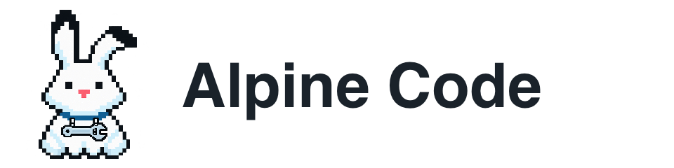

# Alpine Code brand



One snow hare across the desktop app, website and documentation. The selected design is the final centered icon with a horizontal wrench whose open head points to the **viewer’s right**.

## Recognisable features

- Viewer-left ear is upright. Viewer-right ear has an outward kink at the tip.
- White fur, charcoal contour, small eyes and pink nose.
- Blue collar with two loops holding a horizontal steel wrench across the chest.
- Align the **face and torso axis** to the centre, not the bounding box of the asymmetric ears.
- Keep the entire necklace visible, including in the app icon. Leave breathing room around the ears.
- Agent colours belong to the background and accessories. Do not recolour the white fur or mirror the master.

## Files

| Asset | Use |
| --- | --- |
| `source/approved-icon.png` | Approved concept, kept unchanged as the visual reference |
| `source/hare-transparent.png` | Transparent character master |
| `icon.png`, `icon-*.png` | App and web icon exports, from 16 to 1024 pixels; composed from the hare master on a sky-blue macOS tile |
| `icon.icns`, `favicon.ico` | Native macOS and Windows/web formats |
| `hare.png` | Transparent 1024 px character |
| `wordmark.png`, `wordmark-light.png` | Transparent horizontal lockups for light / dark surfaces |
| `social-preview.png` | 1280 × 640 GitHub social preview / website sharing image |
| `agent-collection.png` | Rendered catalogue of all agent looks and colours |
| `source/prompts.md` | Image-generation provenance and extraction prompts |

## Palette and type

| Role | Colour |
| --- | --- |
| Snow | `#FDFEFF` |
| Glacier | `#EAF1F7` |
| Alpine blue | `#2C5A7A` |
| Charcoal | `#1A222A` |
| Nose pink | `#FFAFAF` |

Use Pretendard for product / Korean web text, a system sans-serif fallback, and monospace only for code. The exported English wordmark uses the bundled Pretendard Bold font. The raster master contains shading; these are the semantic UI colours, not a claim that every image pixel is one of these five colours.

## Rebuild

```sh
pnpm install
pnpm brand:build
```

Exports use Sharp for PNG sizing / layout and Tauri's icon exporter for platform formats. The large PNGs are the approved raster artwork; no AI call happens during builds. Do not regenerate the mascot separately for each surface. Accessory geometry is in the desktop `Character` component and the same PNG supplies every character's body. The persisted `antenna` look means the plain snow hare for backwards compatibility.

A 16 px favicon can only suggest the necklace; use at least 48 px when recognition of the wrench matters. Check the `Agent/Character` stories at actual product sizes and on light / dark surfaces when changing art. Avoid smooth enlargement of the pixel art.

## GitHub and hosting

The repository README consumes these files directly. GitHub's repository social-preview setting is separate: upload `social-preview.png` under **Settings → General → Social preview** after the change is merged. A personal GitHub profile avatar is not part of this product's branding and should remain unchanged.

The website sources live in the separate [alpinecode.app repository](https://github.com/hypercodism/alpinecode.app), with Korean (`/ko/`) and English (`/en/`) routes. Copy approved exports into that repository’s `public/brand` when branding changes. `alpinecode.app` is a proposed domain; it has not been registered or connected by this work. Do not set it as a canonical URL until ownership and hosting are configured.
